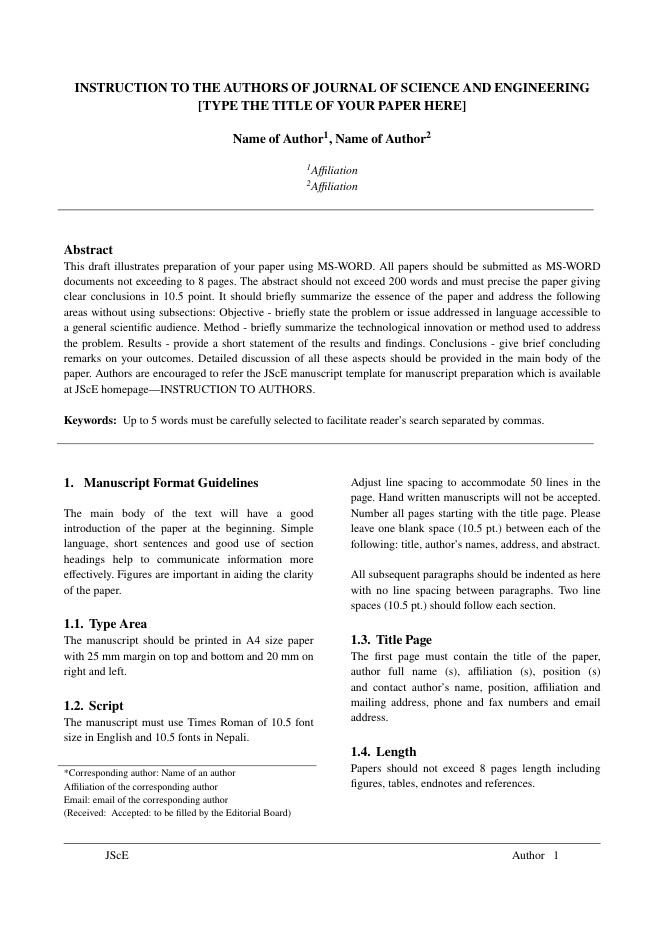
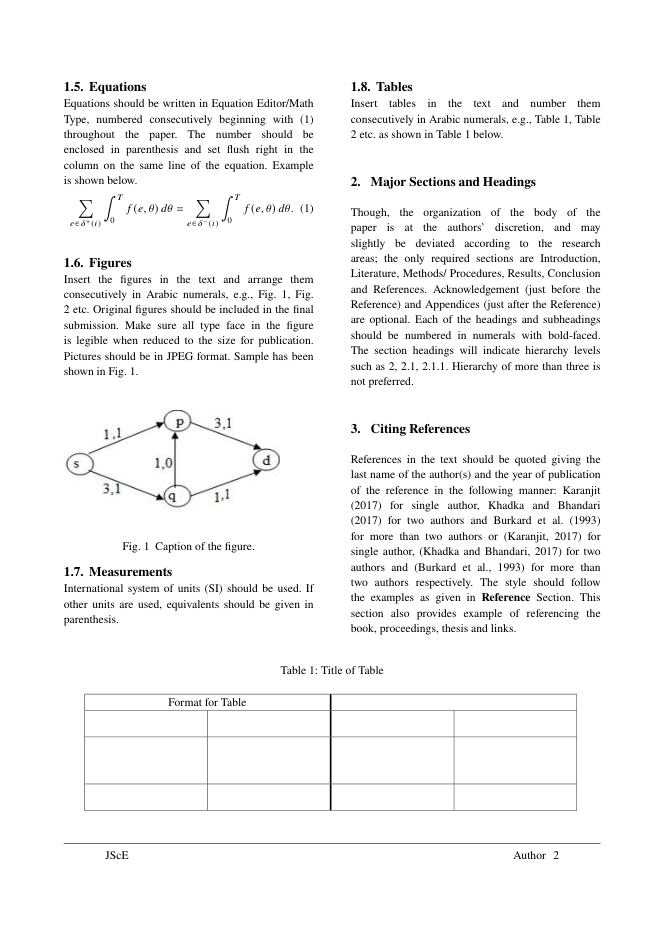
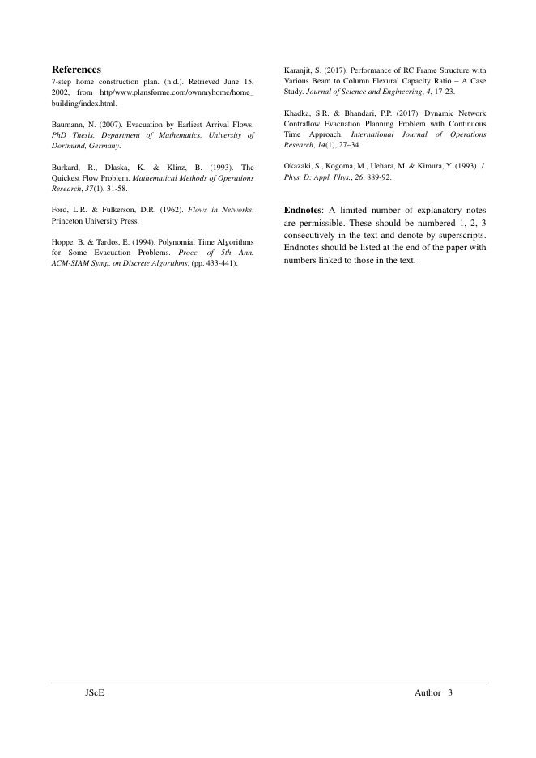

# JScE LaTeX Template (Word format)

A LaTeX template that reproduces the **Journal of Science and Engineering (JScE)** Word
manuscript template (`JScE_Format_new`). The page layout, fonts, spacing, headings, captions,
table style, footer and reference style are the same, so you can write a JScE paper in
LaTeX or Overleaf and get the look of the Word template.

It compiles with **pdfLaTeX**, the default compiler on Overleaf, so it works on the free
Overleaf plan.

> **Note:** This is a community template. It is not published or endorsed by the journal.
> Always check the current
> [JScE Author Guidelines](https://khwopajournals.com/index.php/jsce/about/submissions#authorGuidelines)
> before you submit. JScE also distributes its own LaTeX template (`jsce.cls`) on the journal
> website; this repository instead reproduces the layout of the journal's **Word** template.

| Page 1 | Page 2 | Page 3 |
|:---:|:---:|:---:|
|  |  |  |

## Files

| File | Purpose |
|---|---|
| `jsce-word.cls` | Document class: A4 page, margins, Times-compatible 10.5 pt font, title block, headings, captions, footer, corresponding-author note and reference-list layout |
| `jsce-word.bst` | BibTeX style: author–year citations and the JScE reference format, sorted alphabetically |
| `main.tex` | Sample document containing the text of the Word template |
| `references.bib` | The sample references from the Word template |
| `figures/fig1.jpg` | The sample figure from the Word template |
| `main.pdf` | Compiled sample |
| `JScE_Format_new.doc` | The original JScE Word template, for comparison (not needed in Overleaf) |

## Quick start

### Overleaf (free plan works)
1. On GitHub, click **Code → Download ZIP**.
2. In Overleaf, click **New Project → Upload Project** and select the ZIP file.
3. Keep the compiler as **pdfLaTeX** (the default) and click **Recompile**.

### On your computer
```bash
pdflatex main
bibtex main
pdflatex main
pdflatex main
```
or simply `latexmk -pdf main`.

## Writing your paper

Replace the sample content of `main.tex` with your own. The structure is:

```latex
\documentclass{jsce-word}

\title{TITLE OF YOUR PAPER IN CAPITAL LETTERS}
\author{First Author\textsuperscript{1}, Second Author\textsuperscript{2}}
\affiliation{\textsuperscript{1}Department, Institution, City, Country\\
             \textsuperscript{2}Department, Institution, City, Country}
\corresponding{Name, Position\\
               Affiliation and mailing address\\
               Email: name@example.com}
\keywords{keyword one, keyword two, keyword three, keyword four, keyword five}
\runningauthor{Author}

\begin{document}

\begin{abstract}
Your abstract (not more than 200 words).
\end{abstract}

\maketitle

\section{Introduction}
Text with a citation \citep{karanjit2017}.

\bibliographystyle{jsce-word}
\bibliography{references}

\end{document}
```

### Commands

| Command | What it does |
|---|---|
| `\title{...}` | Title, bold 12 pt, centred. Write it in capital letters as in the Word template. Use `\\` for a line break. |
| `\author{...}` | Author names, bold 12 pt. Add affiliation numbers with `\textsuperscript{1}`. |
| `\affiliation{...}` | Affiliations in italics, one per line (separate them with `\\`). |
| `\corresponding{...}` | Note at the bottom of the first column of page 1. The class adds `*Corresponding author:` at the start and the line `(Received:  Accepted: to be filled by the Editorial Board)` at the end. |
| `\keywords{...}` | Text after **Keywords:** (up to five keywords). |
| `\runningauthor{...}` | Text before the page number in the footer (default `Author`). Use `\runningauthor{}` to show only the page number. |
| `abstract` environment | The abstract. It must come **before** `\maketitle`. |
| `\maketitle` | Prints the title block, abstract and keywords across both columns. |

### Headings, figures, tables and equations

- `\section`, `\subsection` and `\subsubsection` give numbered bold headings: **1.**, **1.1.**, **1.1.1.**
- Figures: `\begin{figure}[H] ... \caption{...} \end{figure}` gives **Fig. 1  Caption** below
  the figure, placed exactly where it appears in the text. Use `[htbp]` instead of `[H]` to
  let LaTeX choose the position.
- Tables: use `table` for one column or `table*` for the full page width. The caption goes
  above the table: **Table 1: Title**. `table*` with `[b]` puts a full-width table at the
  bottom of the page, as in the sample.
- Equations: `\begin{equation} ... \end{equation}` gives a numbered equation with the number
  on the right, e.g. (1).
- If a line of the title starts with `[`, wrap that line in braces, e.g. `{[TITLE]}`.

### Citations and references

| You write | You get |
|---|---|
| `\citet{karanjit2017}` | Karanjit (2017) |
| `\citet{khadka2017}` | Khadka and Bhandari (2017) |
| `\citep{burkard1993}` | (Burkard et al., 1993) |
| `\citep{karanjit2017,khadka2017}` | (Karanjit, 2017; Khadka and Bhandari, 2017) |

Put your references in `references.bib`. `jsce-word.bst` formats them as in the Word
template and sorts them alphabetically by first author:

| Entry type | Output |
|---|---|
| `@article` | Khadka, S.R. & Bhandari, P.P. (2017). Title. *Journal*, *14*(1), 27–34. |
| `@book` | Ford, L.R. & Fulkerson, D.R. (1962). *Flows in Networks*. Princeton University Press. |
| `@inproceedings` | Hoppe, B. & Tardos, E. (1994). Title. *Proceedings name*, (pp. 433-441). |
| `@phdthesis` | Baumann, N. (2007). Title. *PhD Thesis, Department, University, Country*. |
| `@misc` with `url` | Title. (n.d.). Retrieved June 15, 2002, from URL. |

`@mastersthesis`, `@incollection`, `@techreport` and `@unpublished` are also supported. If
an entry has a `doi` field, the DOI link is printed at the end of the reference. Write
author initials with spaces in the `.bib` file (`Khadka, S. R.`); the style prints them as
`S.R.`.

The sample `main.tex` contains `\nocite{*}`, which lists every entry of the `.bib` file even
if it is not cited, so that the whole sample reference list appears. **Remove `\nocite{*}`
in your own paper** so that only the cited references are listed.

Endnotes, if any, are written as a normal paragraph after `\bibliography{...}`, as in the
sample.

## Differences between the Word template and this LaTeX template

The page size, margins, font size, line spacing, title block, rules, two-column layout,
heading sizes, captions, table grid, footnote, footer and reference format follow the Word
template. These are the differences:

| Item | Word template | This LaTeX template | Reason |
|---|---|---|---|
| Font | Times New Roman | Tinos | Times New Roman is not available to pdfLaTeX on Overleaf. Tinos has exactly the same letter widths as Times New Roman, so text takes the same space. |
| Line breaks | Word fills each line one at a time | LaTeX breaks the whole paragraph at once | Some lines end at a different word. Page and column layout are unchanged. |
| Equation | Inserted as a picture | Typeset by LaTeX | Same equation, numbered (1) on the right. |
| Subheadings | 1.1, 1.4 and 1.7 have a different size or a tab gap | All subheadings are 12 pt bold with the same spacing | The Word sample is inconsistent. |
| Space before a section heading | One blank line before Section 2, two before Section 3 | Always two blank lines | The template text asks for two line spaces after each section. |
| Blank line at the top of a column | Word keeps it (e.g. before "1.8 Tables") | LaTeX removes space at the top of a column | Standard LaTeX behaviour. |
| Footer on page 3 | Shows "Author 1" | Shows the correct page number on every page | The Word sample numbers page 3 wrongly. |
| Order of references | In the order they were typed | Alphabetical by first author | Required by the JScE Author Guidelines; produced automatically by `jsce-word.bst`. |
| Okazaki reference | `Okazaki S., Kogoma M., Uehara M. & Kimura Y., 1993. J. Phys. ...` | `Okazaki, S., Kogoma, M., Uehara, M. & Kimura, Y. (1993). J. Phys. ...` | All references use the same style. |
| Online reference | "(n.d.). Retrieved ... from ..." partly in italics | Regular type | All references use the same style. |
| Year of Burkard et al. in the text | Text says 1994, reference list says 1993 | 1993 in both | Citation years come from the reference list. |

Paragraphs follow the Word sample: no first-line indent and one blank line between
paragraphs. Hyphenation is switched off, as in Word.

## Requirements

All packages are part of TeX Live and are available on Overleaf: `newtx`, `tinos`,
`geometry`, `etoolbox`, `environ`, `graphicx`, `float`, `array`, `caption`, `titlesec`,
`fancyhdr`, `stfloats` and `flushend` (from `sttools`), `footmisc`, `natbib`, `url` and
`hyphenat`.

## Credits

The sample text, sample references and sample figure are taken from the JScE Word
manuscript template.
